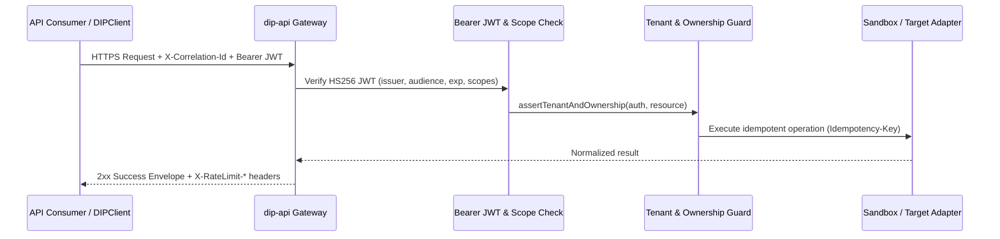

# API Overview and Conventions

**Audience:** Developers, API Consumers, Integrators  
**Access Class:** Developer  
**Owner:** `dip-api` & `DIPINDIA` maintainers  
**Implementation Status:** Mock or sandbox only (`dip-api` `/api/v1` gateway); Implemented and verified (`DIPINDIA` Cloudflare Worker routes)  
**Last Verified:** 2026-11-27

## 1. Two-Layer API Landscape

During the Digital India Project modularization:
- **`dip-api` (`/api/v1`):** The standardized Express API gateway implementing versioned `/api/v1` contracts, OpenAPI 3.1.0 (`GET /api/v1/openapi.json`), strict JWT scope enforcement, idempotency keys, SSRF protection, and structured `ErrorEnvelope` responses. Currently runs in `adapterMode: 'sandbox'` with synthetic data until live `DIPINDIA` and payment connectors are approved.
- **`DIPINDIA` Worker:** The existing Hono-based Cloudflare Worker powering the live portal (`/api/v1/*`, `/api/storage/*`, `/api/admin/*`, `/api/apisathi/*`).

> [!NOTE]
> Never assume `dip-api` sandbox responses reflect live production customer records. In production (`NODE_ENV === 'production'`), `dip-api` disables `POST /api/v1/sandbox/token` and refuses silent fallback to mock adapters unless `DIP_ALLOW_SANDBOX_ADAPTERS=true` is explicitly set.

## 2. Request Lifecycle



## 3. Authentication and Authorization

- **Scheme:** `Authorization: Bearer <jwt>` (HS256 JWT verified via `HmacAuthVerifier`).
- **Required Claims:** `subject`, `actor_type` (`human` | `machine`), `tenant_id`, `scopes[]`, `issuer` (default `dip-security`), `audience` (default `dip-api`), `issued_at`, `expires_at`, `token_id`.
- **Sandbox Token Minting (Non-Production Only):** `POST /api/v1/sandbox/token` issues a 900-second synthetic token for local testing and CI integration suites.
- **Tenant & Ownership Isolation:** Every tenant-scoped endpoint invokes `assertTenantAndOwnership()`. Cross-tenant access returns `403 FORBIDDEN`.

## 4. Versioning and Envelopes

- **Path Versioning:** All gateway endpoints are mounted under `/api/v1`.
- **Success Envelope:** Responses wrap payloads in `buildSuccessEnvelope(data, correlation_id, adapter_mode)` with `correlation_id` echoed in the `X-Correlation-Id` header.
- **Error Envelope (`ErrorEnvelope`):**

```json
{
  "error": {
    "code": "VALIDATION_ERROR",
    "message": "Request validation failed.",
    "correlation_id": "req_01j9example",
    "details": [
      { "field": "service_id", "reason": "Required" }
    ]
  }
}
```

**Verified `ErrorEnvelope` Codes:** `VALIDATION_ERROR`, `UNAUTHENTICATED`, `FORBIDDEN`, `NOT_FOUND`, `RATE_LIMITED`, `IDEMPOTENCY_CONFLICT`, `PROVIDER_UNAVAILABLE`, `INTERNAL_ERROR`.

## 5. Pagination, Rate Limits, and Idempotency

- **Pagination:** List endpoints accept `page` (default `1`) and `limit` (default `20`) query parameters.
- **Rate Limiting:** Configured via `RATE_LIMIT_WINDOW_MS` (default `60000` ms) and `RATE_LIMIT_MAX_REQUESTS` (default `120` requests per client key `client:<tenant_id>:<subject>` or IP). Responses return `X-RateLimit-Limit`, `X-RateLimit-Remaining`, `X-RateLimit-Reset`, and `Retry-After` on `429 RATE_LIMITED`.
- **Idempotency:** Mutating `POST` routes (`applications`, `submit`, `transition`, `documents/upload-intent`, `payments/orders`, `refunds`, `webhooks/subscriptions`) require an `Idempotency-Key` header matching `^[a-zA-Z0-9_-]{8,128}$`. Reusing the same key with a different payload returns `409 IDEMPOTENCY_CONFLICT`.

## 6. Webhooks and File Operations

- **Document Upload Intents:** `POST /api/v1/applications/:applicationId/documents/upload-intent` issues a validated upload intent for `identity_proof`, `address_proof`, `business_incorporation`, or `tax_certificate`. Direct file binary downloads remain in `DIPINDIA` (`/api/storage/files/:id/download`).
- **Outbound Webhooks:** `POST /api/v1/webhooks/subscriptions` enforces SSRF validation (`ssrf.ts`), rejecting private IP ranges and non-HTTPS targets.
- **Inbound Cashfree Webhooks:** `POST /api/v1/payments/webhooks/cashfree` verifies HMAC-SHA256 signatures, timestamp freshness, and event deduplication.
