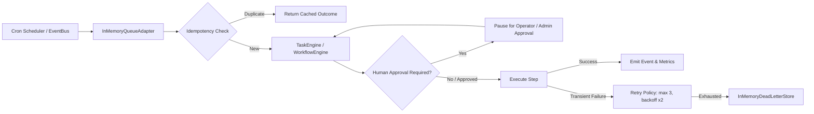

# Automation Platform (`dip-automation`)

**Audience:** Platform Engineers, Backend Developers  
**Access Class:** Developer / Internal  
**Owner:** `dip-automation` maintainers  
**Implementation Status:** Implemented in-memory/local engine (`dip-automation`); external provider integrations are mock adapters  
**Last Verified:** 2026-11-27

## 1. Verified Engine Capabilities

`dip-automation` (`src/platform/index.ts`) provides a modular TypeScript automation runtime (`createAutomationPlatform()`) tested via Node's native test runner (`node --experimental-strip-types --test`):

| Module | Implementation | Verified Capabilities |
|---|---|---|
| `TaskEngine` | `src/platform/task-engine/TaskEngine.ts` | Executes registered tasks with input validation, retry wrapping, and idempotency keys |
| `WorkflowEngine` | `src/platform/workflow-engine/WorkflowEngine.ts` | Multi-step workflows supporting automated steps and **human approval gates** |
| `InMemoryScheduler` | `src/platform/scheduler/Scheduler.ts` | Parses `jobs.yaml` cron expressions, schedules jobs, and enforces step timeouts |
| `EventBus` | `src/platform/event-bus/EventBus.ts` | Typed internal pub/sub event dispatch across automation modules |
| `InMemoryQueueAdapter` | `src/platform/queues/InMemoryQueue.ts` | Asynchronous job queueing backed by `InMemoryDeadLetterStore` (DLQ) |
| `Reliability` | `retry.ts`, `idempotency.ts`, `dlq.ts` | Exponential backoff, deduplicated execution via `InMemoryIdempotencyStore`, DLQ capture |
| `Observability` | `Observability.ts` | `StructuredLogger`, `MetricsCollector`, and `HealthMonitor` |

## 2. Verified `jobs.yaml` Schedule Catalogue

| Job Name | Cron Schedule | Script | Timeout | Description |
|---|---|---|---|---|
| `daily_data_ingestion` | `0 2 * * *` | `scripts/ingest-data.ts` | `30m` | Daily data ingestion at 02:00 |
| `weekly_status_report` | `0 9 * * 1` | `scripts/status-report.ts` | `1h` | Weekly status report every Monday at 09:00 |
| `monthly_security_scan` | `0 3 1 * *` | `scripts/security-scan.ts` | `2h` | Monthly security scan on the 1st at 03:00 |

## 3. Retry and Idempotency Policy (`jobs.yaml`)

- **Default `retry_policy`:** `max_attempts: 3`, `backoff_factor: 2`, `max_delay: "1h"`.
- **Webhook Target Placeholder:** Configured via `${DIP_WEBHOOK_SECRET}` environment variable (never hardcode secrets).
- **Current Runtime Constraint:** Queue, scheduler, idempotency, and DLQ stores are currently **in-memory implementations** (`InMemory*`). Persistent distributed backing and live external adapters (`createMockExternalAdapters`) require production adapter wiring before live workloads.

## 4. Automation Workflow Diagram

