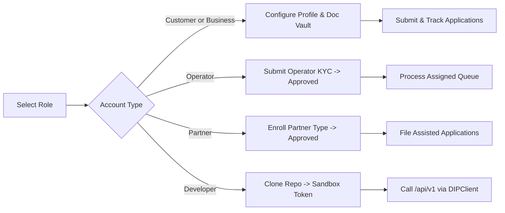

# Orientation and Onboarding

**Audience:** Public, Developers, Partners, Operators  
**Access Class:** Public / Developer  
**Owner:** `dip-docs`, `DIPINDIA`, `dip-api`, `dip-sdk` maintainers  
**Implementation Status:** Implemented and verified (varies by repository; noted per section)  
**Last Verified:** 2026-11-27

## 1. Platform Orientation

Before using or integrating with Digital India Project, identify your primary role and target surface:

| Persona | Primary Interface | Starting Guide |
|---|---|---|
| Customer / Business User | `DIPINDIA` Web Portal (`dashboard` / `b2b` workspace) | [Partner, Customer & Business Guide](../user-guides/partner-customer-business.md) |
| Partner / Agent | `DIPINDIA` Partner Desk (`partner` workspace) | [Partner, Customer & Business Guide](../user-guides/partner-customer-business.md) |
| Operator / Manager | `DIPINDIA` Operator & Manager Workspaces | [Manager & Operator Guide](../user-guides/manager-and-operator.md) |
| Administrator / Super Admin | `DIPINDIA` Admin Console (`admin` workspace) | [Admin & Super Admin Guide](../user-guides/admin-and-super-admin.md) |
| API / SDK Developer | `dip-api` (`/api/v1`) & `@digital-india/sdk` | [API Overview](../api/api-overview.md) & [SDK Guide](../sdk/sdk-guide.md) |

## 2. User Onboarding Flows (Verified in `DIPINDIA`)

### Customer Onboarding
1. Create an account via the authentication flow (`customer` default role).
2. Complete profile details (`name`, `email`, `mobile`).
3. Optionally upload identity and address proofs to the **Document Vault** (`/api/v1/vault` or `/api/storage/upload`) to reuse documents across applications.
4. Browse the [Service Catalogue](../services/service-catalogue.md), submit an application, and monitor progress on the tracking view.

### Operator Onboarding & KYC (`operator`)
Operators must complete KYC verification before full desk privileges are active:
- **Verified `OperatorKycStatus` states:** `Not Submitted` → `KYC Submitted` → `Under Verification` → `Resubmission Required` / `Approved` / `Rejected`.
- Until `kycStatus === 'Approved'`, `getHomeRouteForRole()` routes operators to `operator-enroll` (`My KYC`).

### Partner Onboarding (`partner`)
Partners onboard via `POST /api/v1/partners/enroll` under one of four verified `PartnerType` classifications:
- `individual_agent`
- `csc_center`
- `franchise`
- `corporate_connector`
- **Verified `PartnerApprovalStatus` states:** `Not Submitted` → `Pending Approval` → `Approved` / `Suspended` / `Rejected`.

### Business / B2B Onboarding (`business`)
Business users configure their organization profile (`POST /api/v1/b2b/profile`), manage team members (`POST /api/v1/b2b/members`), and rotate API keys (`POST /api/v1/b2b/rotate-key`) inside the B2B console.

## 3. Developer Onboarding & Local Environment Setup

### Prerequisites
- **Node.js:** `22.x` LTS (verified across `dip-api`, `dip-automation`, `dip-docs`, `dip-infrastructure`).
- **Package manager:** `npm` (or `bun` where lockfiles exist in upstream repos; AI Studio and CI standardize on `npm`).
- **Git:** Standard clone with read access to target repositories.

### Running `dip-api` Locally in Sandbox Mode

```bash
git clone https://github.com/Digital-India-Project/dip-api.git
cd dip-api
npm install
cp .env.example .env
npm run dev
```

Verify the local gateway responds on port `3000`:

```bash
curl -s http://localhost:3000/api/v1/health
```

Mint a non-production sandbox JWT token (`NODE_ENV !== 'production'` only):

```bash
curl -s -X POST http://localhost:3000/api/v1/sandbox/token \
  -H "Content-Type: application/json" \
  -d '{
    "subject": "usr_dev_01",
    "tenant_id": "tenant_sandbox_01",
    "actor_type": "human",
    "scopes": ["applications:read", "applications:write"]
  }'
```

### Installing and Testing `@digital-india/sdk` (`dip-sdk`)

```bash
git clone https://github.com/Digital-India-Project/dip-sdk.git
cd dip-sdk
npm install
npm run test
npm run build
```

### Running `dip-docs` Locally

```bash
git clone https://github.com/Digital-India-Project/dip-docs.git
cd dip-docs
npm install
npm run dev
npm run docs:validate
```

## 4. Common Onboarding Workflows



## 5. Troubleshooting

| Symptom | Likely Cause | Verified Resolution |
|---|---|---|
| Operator redirected to `operator-enroll` instead of `operator` queue | `kycStatus` is not `Approved` | Complete KYC submission and wait for manager/admin approval (`operators.assign`). |
| `POST /api/v1/sandbox/token` returns `404` or SDK rejects call | `NODE_ENV === 'production'` or `adapterMode === 'strict'` | Sandbox token minting is disabled in production; use an approved token issuer. |
| `400 VALIDATION_ERROR` on `POST /api/v1/applications` | Missing `Idempotency-Key` header or invalid payload | Supply an `Idempotency-Key` matching `^[a-zA-Z0-9_-]{8,128}$` and verify required fields. |
| `403 FORBIDDEN` on document or application read | Missing scope or cross-tenant/non-owner access | Verify bearer token `tenant_id`, `subject`, and required scope (`applications:read`, `documents:read`). |
| `415` or upload validation error in `DIPINDIA` | Disallowed MIME type or mismatched magic bytes | Upload only `application/pdf`, `image/jpeg`, `image/png`, or `image/webp` matching actual file headers. |
