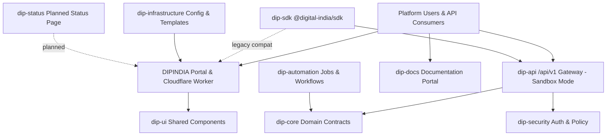

# Platform Overview

**Audience:** All audiences (Public, Developer, Partner, Internal)  
**Access Class:** Public  
**Owner:** `dip-docs` & `DIPINDIA` maintainers  
**Implementation Status:** Implemented and verified (`DIPINDIA` core portal); modular ecosystem services vary by repository  
**Last Verified:** 2026-11-27

## 1. Introduction and Private Platform Positioning

Digital India Project (`DIPINDIA`) is a **private digital services, documentation assistance, and technology platform**. It provides structured workflows, document management, assisted service filing, digital template products, and developer tooling for individuals, businesses, partners, and internal operations teams.

> [!NOTE]
> Digital India Project is a private service and technology company. It is not a government portal, is not owned or endorsed by any government authority, and does not guarantee official processing timelines, statutory eligibility, or regulatory outcomes.

## 2. Core Platform Capabilities

Based on verified inspection of `DIPINDIA` and the ecosystem repositories, the platform spans three functional layers:

1. **Public Service & Product Portal (`DIPINDIA`)**:
   - Service discovery across 8 primary catalogue categories (`CAT_A` through `CAT_H`) plus bundled service packages.
   - Guided application submission, dynamic form validation, document vault uploads, and status tracking.
   - Instant-download digital products (templates, workbooks, starter bundles) and utility tools.
   - Role-scoped workspaces for customers, business accounts, partners, operators, managers, and administrators.
2. **Modular Domain, UI, API, and SDK Layer (In-Progress Modularization)**:
   - `dip-core`: Pure TypeScript domain models, integer-paise money math, form validation schemas, and application/payment state machines.
   - `dip-ui`: Shared React 19 + Tailwind CSS v4 component library, tokens, charts, and English/Hindi i18n helpers.
   - `dip-api`: Versioned `/api/v1` Express gateway currently operating in isolated `sandbox` adapter mode.
   - `dip-sdk`: `@digital-india/sdk` client library with typed resources, bounded retries, idempotency helpers, and Cashfree webhook signature verification.
3. **Security, Automation, and Infrastructure Governance**:
   - `dip-security`: Identity, RBAC, tenant isolation, cryptography, SSRF protection, and webhook verification contracts.
   - `dip-automation`: Task engine, approval workflows, cron scheduler (`jobs.yaml`), event bus, and in-memory queue/DLQ primitives.
   - `dip-infrastructure`: Sanitized infrastructure schema validation and Cloudflare/container configuration templates.
   - `dip-status`: Planning-stage specification for future privacy-safe public service status reporting.

## 3. Ecosystem Architecture Map

## 4. Platform Terminology

| Term | Verified Meaning |
|---|---|
| `DIPINDIA` | The primary functional web portal and Cloudflare Worker backend (`Digital-India-Project/DIPINDIA`). |
| `Catalogue Category` | One of 8 verified service groupings (`CAT_A` to `CAT_H`) defined in `src/data/catalogue/categories.ts`. |
| `Application` | A tracked customer, business, or assisted filing request progressing through `ApplicationStatus` stages. |
| `Document Vault` | Encrypted/access-controlled storage area for reusable applicant identity and compliance proofs. |
| `Partner` | An onboarded individual agent, CSC center, franchise, or corporate connector filing assisted applications. |
| `Operator` | A KYC-verified internal desk specialist handling walk-in intake, document review, and processing. |
| `Manager` | An operations lead overseeing SLAs, operator assignment, escalations, and partner activity. |
| `B2B / Business` | A business account accessing bulk verification, API keys, and audit logs. |
| `Sandbox Mode` | Isolated non-production mode in `dip-api` using synthetic data and `POST /api/v1/sandbox/token`. |
| `Idempotency-Key` | Client-supplied header (`^[a-zA-Z0-9_-]{8,128}$`) required on mutating `/api/v1` POST routes to prevent duplicate writes. |

## 5. Frequently Asked Questions

### Is Digital India Project affiliated with the Government of India?
No. Digital India Project is a private technology and service assistance platform. Assisted filings that require external portals are submitted on behalf of requesting users or tracked through verified provider boundaries where authorized.

### Which repository is the source of truth for live product behavior?
`DIPINDIA` is the authoritative source of truth for existing product behavior until individual capabilities are formally migrated and verified in modular repositories (`dip-api`, `dip-core`, `dip-security`).

### Are all documented APIs live in production today?
No. While `DIPINDIA` serves active worker routes, the standalone `dip-api` gateway currently operates in **isolated sandbox adapter mode** (`adapterMode: 'sandbox'`) with synthetic data. Live connectors for DigiLocker, Entity Locker, GST, and PAN remain `planned_unconnected` until commercial and security approvals are complete.

### Where can I read documentation in Hindi?
Use the language selector in the workspace toolbar or visit the [Hindi Overview](../hi/README.md). Critical security and legal policies remain authoritative in English when Hindi translations are marked pending.

## Related Documentation

- [Orientation and Onboarding](../getting-started/orientation-and-onboarding.md)
- [Roles and Permissions](../user-guides/roles-and-permissions.md)
- [Application Lifecycle](../workflows/application-lifecycle.md)
- [Integration Contract](../INTEGRATION.md)
