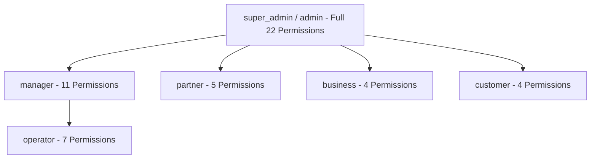

# Roles and Permissions Matrix

**Audience:** Administrators, Managers, Operators, Partners, Customers, Business Users, Security Engineers  
**Access Class:** Public / Internal Reference  
**Owner:** `DIPINDIA` & `dip-security` maintainers  
**Implementation Status:** Implemented and verified (`DIPINDIA/src/lib/rbac.ts`)  
**Last Verified:** 2026-11-27

## 1. Verified Role Taxonomy

`DIPINDIA` defines seven canonical `UserRole` values in `src/types.ts` and normalizes aliases (`superadmin` → `super_admin`, `agent` → `partner`, `b2b` → `business`) via `normalizeRole()` in `src/lib/rbac.ts`:

| Role Key | Normalization Aliases | Default Home Route | Primary Workspace |
|---|---|---|---|
| `super_admin` | `superadmin` | `admin` (`overview`) | Global Administration Console |
| `admin` | `admin` | `admin` (`overview`) | Operational Administration Console |
| `manager` | `manager` | `manager` (`sla`) | SLA Queue, Assignment & Escalation Desk |
| `operator` | `operator` | `operator` (`queue`) or `operator-enroll` | Operator Desk & Walk-In Intake |
| `partner` | `partner`, `agent` | `partner` (`overview`) | Partner Desk & Assisted Filings |
| `customer` | `customer` (default fallback) | `dashboard` (`overview`) | Citizen Dashboard & Doc Vault |
| `business` | `business`, `b2b` | `b2b` (`overview`) | B2B Console & API Keys |

> [!NOTE]
> `dip-core` and `dip-api` enforce tenant and ownership isolation (`assertTenantAndOwnership`) at the API boundary in addition to role-level scopes. Never rely on UI route hiding for authorization.

## 2. Role Hierarchy and Access Boundaries

## 3. Verified 22-Permission Matrix (`DEFAULT_ROLE_PERMISSIONS`)

All 22 `PermissionCode` identifiers below are verified directly from `DIPINDIA/src/lib/rbac.ts`. Note that both `super_admin` and `admin` resolve to `isSuperAdminRole() === true` in `rbac.ts`, granting all 22 permissions by default unless constrained by explicit server-side route checks.

| Permission Code | Group | `super_admin` / `admin` | `manager` | `operator` | `partner` | `customer` | `business` |
|---|---|---|---|---|---|---|---|
| `applications.view` | Applications | Yes | Yes | Yes | Yes | Yes | Yes |
| `applications.create` | Applications | Yes | Yes | Yes | Yes | Yes | Yes |
| `applications.assign` | Applications | Yes | Yes | No | No | No | No |
| `applications.process` | Applications | Yes | Yes | Yes | No | No | No |
| `applications.verify_documents` | Applications | Yes | Yes | Yes | No | No | No |
| `applications.request_correction` | Applications | Yes | Yes | Yes | Yes | Yes | No |
| `applications.complete` | Applications | Yes | Yes | Yes | No | No | No |
| `applications.cancel` | Applications | Yes | No | No | No | No | No |
| `services.create` | Services & Forms | Yes | No | No | No | No | No |
| `services.edit` | Services & Forms | Yes | No | No | No | No | No |
| `services.publish` | Services & Forms | Yes | No | No | No | No | No |
| `users.manage` | Governance | Yes | No | No | No | No | No |
| `operators.assign` | Governance | Yes | Yes | No | No | No | No |
| `partners.manage` | Partners | Yes | Yes | No | No | No | No |
| `commissions.manage` | Finance | Yes | No | No | No | No | No |
| `payments.view` | Finance | Yes | Yes | Yes | Yes | Yes | Yes |
| `payments.refund` | Finance | Yes | No | No | No | No | No |
| `reports.view` | Analytics | Yes | Yes | No | Yes | No | Yes |
| `settings.manage` | Administration | Yes | No | No | No | No | No |
| `audit_logs.view` | Administration | Yes | No | No | No | No | No |
| `rbac.manage` | Administration | Yes | No | No | No | No | No |
| `integrations.manage` | Administration | Yes | No | No | No | No | No |

## 4. Custom Permission Overrides

`hasPermission(user, permission, customMatrix)` evaluates permissions in the following verified order:
1. If `user` is null/undefined → returns `false`.
2. If `isSuperAdminRole(user.role)` is `true` → returns `true`.
3. If `user.permissions` is a non-empty array → checks `user.permissions.includes(permission)`.
4. Otherwise falls back to `customMatrix[normalizedRole]` or `DEFAULT_ROLE_PERMISSIONS[normalizedRole]`.

## 5. `dip-api` OAuth / JWT Scope Mapping (Contract Layer)

In the modular `dip-api` gateway (`src/server/routes/v1/`), machine and human bearer tokens carry explicit string scopes rather than coarse role names alone:
- `applications:read`, `applications:write`
- `workflow:review`
- `documents:read`, `documents:write`, `documents:tenant_read`
- `payments:read`, `payments:write`, `payments:refund`
- `webhooks:read`, `webhooks:write`
- `integrations:read`, `integrations:write`

## Related Guides

- [Super Administrator & Administrator Guide](admin-and-super-admin.md)
- [Manager & Operator Guide](manager-and-operator.md)
- [Partner, Customer & Business User Guide](partner-customer-business.md)
