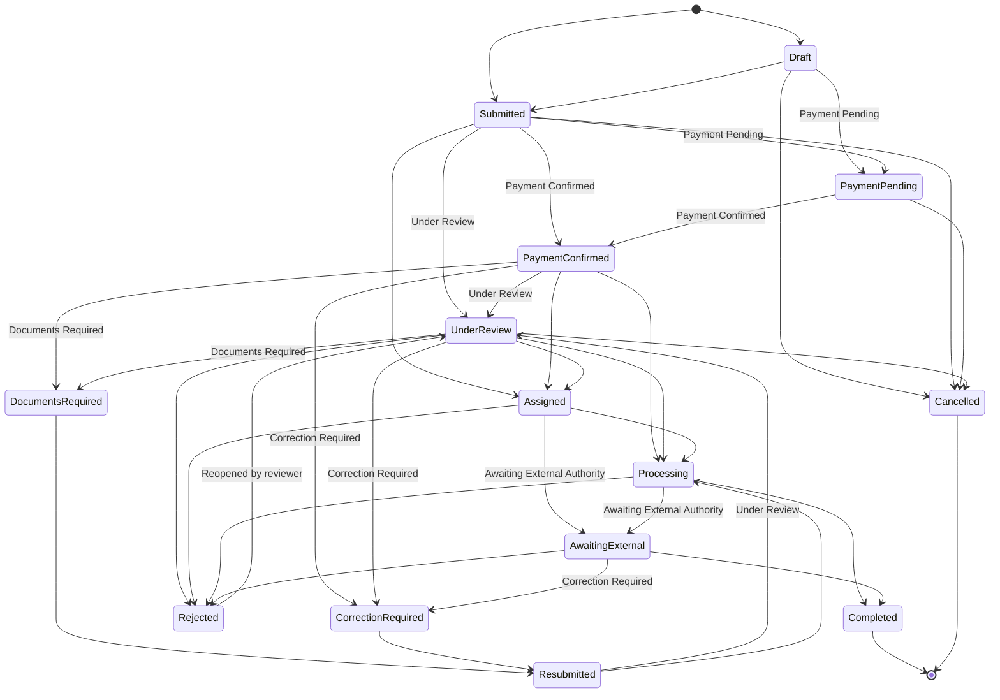

# Application Lifecycle and Workflows

**Audience:** Developers, Operators, Managers, Partners, Customers  
**Access Class:** Public / Developer  
**Owner:** `DIPINDIA` & `dip-core` maintainers  
**Implementation Status:** Implemented and verified (`DIPINDIA/src/lib/workflow.ts`, `DIPINDIA/src/types.ts`, `dip-api` contracts)  
**Last Verified:** 2026-11-27

## 1. Five-Stage Progress Model

In `DIPINDIA/src/lib/workflow.ts`, `getApplicationProgress(status)` maps every application onto five user-facing stages (`Submitted` → `Payment` → `Verification` → `Processing` → `Completed`) with visual buckets (`Pending`, `Processing`, `Completed`, `Halted`).

## 2. Canonical and Extended Status Definitions

`DIPINDIA/src/lib/workflow.ts` defines 14 `CANONICAL_WORKFLOW_STATUSES` and supports 24 total `ApplicationStatus` values in `src/types.ts`:

| Status | Canonical? | Progress % | Visual Bucket | Verified Meaning |
|---|---|---|---|---|
| `Draft` | Yes | 10% | Pending | Draft saved; form & payment not yet submitted |
| `Submitted` | Yes | 20% | Pending | Submitted; awaiting initial payment & desk intake |
| `Payment Pending` / `Awaiting Payment` | Yes (`Payment Pending`) | 28% | Pending | Waiting for payment confirmation |
| `Payment Confirmed` / `Payment Successful` | Yes (`Payment Confirmed`) | 40% | Processing | Payment confirmed; queued for officer assignment |
| `Under Review` | Yes | 55% | Pending | Assigned to verification desk for initial review |
| `Assigned` | Yes | 55% | Pending | Assigned to a specific operator |
| `Document Verification` | Extended | 62% | Pending | Reviewing identity, eligibility, and supporting files |
| `Documents Required` | Yes | 52% | Pending | Applicant action needed to upload missing records |
| `Correction Required` | Yes | 52% | Pending | Applicant action needed to correct submitted details |
| `Resubmitted` | Yes | 65% | Processing | Updated documents received; awaiting re-verification |
| `Processing` / `Application Processing` | Yes (`Processing`) | 78% | Processing | Documents verified; active processing underway |
| `Awaiting External Authority` | Yes | 88% | Processing | Submitted externally; pending third-party/authority outcome |
| `Submitted to Provider` / `Submitted to External Authority` / `Verification Pending` / `Awaiting External Approval` | Extended | 88% | Processing | External submission / verification pending |
| `Completed` | Yes | 100% | Completed | Approved and final deliverable/certificate issued |
| `Rejected` | Yes | 50% | Halted | Rejected during review with officer remarks (can reopen to `Under Review`) |
| `Cancelled` | Yes | 0% | Halted | Cancelled prior to completion (terminal) |
| `Refund Initiated` | Extended | 70% | Processing | Refund approved and processing to payment source |
| `Refunded` | Extended | 100% | Halted | Closed and fee refunded (terminal) |

## 3. Verified State Transition Graph (`ALLOWED_TRANSITIONS`)

## 4. `dip-api` Modular Contract Alignment

The standalone `dip-api` gateway (`src/server/contracts/domain.ts`) exposes a simplified 6-state contract (`draft`, `submitted`, `under_review`, `action_required`, `approved`, `rejected`) via `POST /api/v1/applications/:applicationId/transition` (requiring `workflow:review` scope and `Idempotency-Key`). During migration, `dip-core` (`applicationLifecycle.ts` and `dipindiaAdapters.ts`) provides explicit mapping between `DIPINDIA`'s 24 statuses and the modular domain contract.

## 5. Source Channels (`ApplicationSourceChannel`)

Every application tracks its origin across six verified channels in `DIPINDIA/src/types.ts`:
- `web_b2c` — Direct customer self-service submission
- `b2b_portal` — Business organization submission
- `operator_assisted` — Walk-in or operator-assisted intake
- `partner_assisted` — Partner/agent-assisted submission
- `google_forms` — Legacy/imported form intake channel
- `admin_manual` — Manual administrative creation
